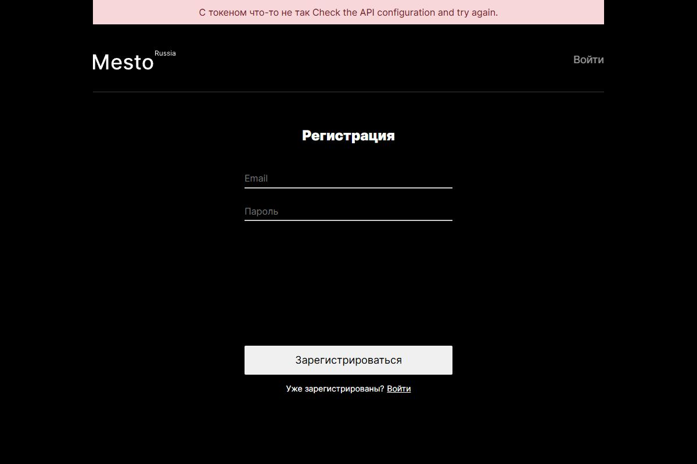

<div align="center">

# 🔐 Mesto · регистрация и вход

**Учебный React-клиент с отдельными маршрутами регистрации, входа и защищённой фотоленты.**

  

[Открыть клиент](https://goldlexx.github.io/react-mesto-auth/) · [Полная версия с собственным API](https://goldlexx.github.io/react-mesto-api-full/)

</div>



## Путь пользователя

Страница `/sign-up` принимает email и пароль. На `/sign-in` клиент отправляет данные входа и сохраняет полученный JWT в `localStorage`. При следующем открытии [модуль авторизации](src/utils/apiAuth.js) запрашивает `/users/me` с Bearer-токеном. Выход удаляет токен, а компонент защищённого маршрута ограничивает доступ к ленте.

После входа доступны формы профиля и аватара, добавление места по ссылке, просмотр фотографии, лайки и удаление своих карточек. Успех сохранения зависит от сервиса карточек.

## Два API

| Переменная в `.env.local` | Назначение |
| --- | --- |
| `REACT_APP_AUTH_API_BASE_URL` | Регистрация, вход и проверка JWT |
| `REACT_APP_API_BASE_URL` | Профиль, аватар, карточки и лайки |

По умолчанию указаны исторические сервисы Практикума. [Модуль карточек](src/utils/api.js) отправляет запросы отдельно от модуля входа и не передаёт сохранённый JWT в своих стандартных заголовках. Доступность формы регистрации на Pages сама по себе не подтверждает доступ к ленте. На опубликованной странице при подготовке снимка также отображалось сообщение об ошибке доступа к API.

## Локальная разработка

Из корня репозитория установите зависимости, при необходимости задайте оба адреса в `.env.local`, затем запустите React-клиент.

```sh
npm ci
npm start
```

Для сборки используется `npm run build`. Команда `npm test -- --watchAll=false` запускает тесты формирования запроса создания карточки и обработки ошибочных HTTP-ответов.
